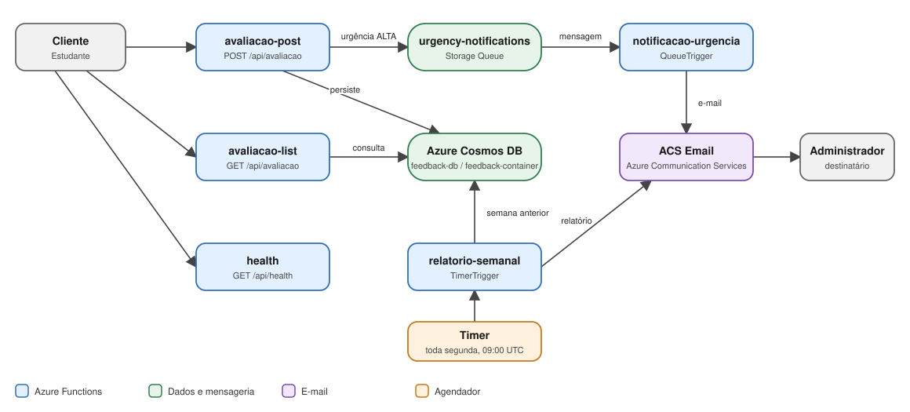

# Feedback Platform

Plataforma serverless para coleta e análise de feedbacks de aulas, desenvolvida para o Tech Challenge da Fase 4 (FIAP). Estudantes enviam avaliações via HTTP; administradores recebem alertas imediatos para feedbacks críticos e um relatório semanal consolidado.

A solução é implementada em **Java 21** sobre **Azure Functions (Runtime 4)**, com persistência em **Azure Cosmos DB**, mensageria em **Azure Storage Queue** e envio de e-mails via **Azure Communication Services (ACS) Email**. Uma API **Spring Boot** equivalente permite execução e depuração locais dos mesmos endpoints.
 
---

## Sumário

1. [Requisitos do desafio e cobertura](#1-requisitos-do-desafio-e-cobertura)
2. [Arquitetura](#2-arquitetura)
3. [Modelo de nuvem e componentes](#3-modelo-de-nuvem-e-componentes)
4. [Contrato da API](#4-contrato-da-api)
5. [Documentação das Functions](#5-documentação-das-functions)
6. [Configuração](#6-configuração)
7. [Execução local](#7-execução-local)
8. [Build e deploy](#8-build-e-deploy)
9. [Monitoramento e alertas](#9-monitoramento-e-alertas)
10. [Segurança e governança de acesso](#10-segurança-e-governança-de-acesso)
11. [Limitações conhecidas](#11-limitações-conhecidas)
12. [Estrutura do código](#12-estrutura-do-código)
13. [Autores](#13-autores)
---

## 1. Requisitos do desafio e cobertura

| Requisito | Implementação |
| --- | --- |
| Aplicação serverless em nuvem | Azure Functions (Windows, plano Consumption, Java 21, Runtime 4) |
| Mínimo de 2 funções, com responsabilidade única | 5 functions, cada uma com um único gatilho e uma única responsabilidade (seção 5) |
| Banco de dados e componentes de suporte | Azure Cosmos DB (NoSQL), Azure Storage (fila e estado do runtime), ACS Email |
| Notificação automática para itens críticos | `notificacao-urgencia` envia e-mail ao administrador para urgência `ALTA` |
| Relatório semanal com média de avaliações | `relatorio-semanal` (Timer Trigger, segunda-feira 09:00 UTC) |
| Segurança e governança de acesso | Segredos em App Settings, RBAC no Resource Group, `DefaultAzureCredential` (seção 10) |
| Deploy automatizado | GitHub Actions a cada push na `main` (seção 8) |
| Aplicação monitorada | Application Insights, alerta crítico e grupo de ações (seção 9) |
| Notificação aos administradores para problemas críticos | Regra de alerta `alerta-falhas-feedback` (severidade 0 - Crítico) com e-mail via grupo de ações (seção 9) |
 
---

## 2. Arquitetura



```text
Cliente → POST /api/avaliacao → [avaliacao-post] → Cosmos DB
                                      │ (se urgência ALTA)
                                      ▼
                          Fila urgency-notifications
                                      ▼
                      [notificacao-urgencia] → ACS Email → Administrador
 
Timer (segunda, 09:00 UTC) → [relatorio-semanal] → Cosmos DB → ACS Email → Administrador
 
Todas as functions → Application Insights → Alerta crítico → Grupo de ações → E-mail
```

### Fluxo de um feedback crítico

1. O cliente envia `POST /api/avaliacao` com `urgencia = ALTA`.
2. `avaliacao-post` valida o payload, persiste o documento no Cosmos DB e publica uma mensagem em `urgency-notifications`.
3. `notificacao-urgencia` é acionada pela mensagem e envia ao administrador (`AZURE_NOTIFICATION_EMAIL`) um e-mail com **descrição**, **urgência** e **data de envio**.
4. Em caso de falha no envio, a exceção é registrada e propagada, permitindo que o runtime reprocesse a mensagem conforme a política de retry de filas do Azure Functions.
### Desacoplamento

O recebimento do feedback e o envio de notificação são separados por uma fila. Isso evita que a latência ou a indisponibilidade do serviço de e-mail afete a resposta ao cliente e permite reprocessamento independente.
 
---

## 3. Modelo de nuvem e componentes

**Modelo:** nuvem pública (Microsoft Azure), no modelo Function-as-a-Service (FaaS), com serviços gerenciados (PaaS) para dados, mensageria e monitoramento. Não há servidores para administrar: o código executa apenas quando acionado e o custo é proporcional ao uso.

| Componente | Serviço Azure | Responsabilidade |
| --- | --- | --- |
| Computação | Azure Functions (Runtime 4, Java 21, Windows, Consumption) | Execução orientada a eventos (HTTP, fila, timer) |
| Persistência | Azure Cosmos DB (NoSQL) | Armazenamento dos feedbacks |
| Mensageria | Azure Storage Queue (`urgency-notifications`) | Desacoplamento entre recebimento e notificação |
| Estado do runtime | Azure Storage (`AzureWebJobsStorage`) | Gatilhos de fila e timer, controle de execução |
| E-mail | Azure Communication Services Email | Alertas e relatório semanal |
| Monitoramento | Application Insights + Log Analytics | Telemetria, logs e alertas |
| Alertas | Azure Monitor (regra de alerta + grupo de ações) | Notificação dos administradores |

### Ambiente provisionado na Azure

| Item | Valor |
| --- | --- |
| Function App | `app-261014193432` |
| Resource group | `rg-app-261014193432` |
| Região | Central US |
| Plano de hospedagem | `asp-app-261014193432` (Consumption, SKU Y1) |
| Sistema operacional | Windows |
| Java | 21 |
| `FUNCTIONS_EXTENSION_VERSION` | `~4` |
| Extension bundle (`host.json`) | `Microsoft.Azure.Functions.ExtensionBundle` `[4.*, 5.0.0)` |
| Application Insights | `app-261014193432` |
| Grupo de ações | `ag-admins-feedback` |
| Regra de alerta | `alerta-falhas-feedback` |

**Por que Consumption:** o plano cobra somente pelo tempo de execução e escala a zero quando não há tráfego. O volume de feedbacks é baixo e imprevisível, e o projeto roda com crédito de cloud limitado, então pagar por uso é a opção mais econômica. O custo é o cold start, aceitável para este cenário.
 
---

## 4. Contrato da API

As rotas são idênticas na API Spring (`http://localhost:8080/avaliacao`) e nas Azure Functions (`/api/avaliacao`).

### `POST /avaliacao`

Cria um feedback.

**Corpo da requisição**

| Campo | Tipo | Obrigatório | Regras |
| --- | --- | --- | --- |
| `descricao` | string | Sim | Texto livre do feedback |
| `nota` | inteiro | Sim | Entre 0 e 10 (inclusive) |
| `urgencia` | string | Sim | `BAIXA`, `MEDIA` ou `ALTA`. Case-insensitive; também aceita `Média` |

```bash
curl -X POST http://localhost:8080/avaliacao \
  -H "Content-Type: application/json" \
  -d '{
    "descricao": "Atendimento muito bom",
    "nota": 9,
    "urgencia": "Alta"
  }'
```

**Mensagens de validação** (Bean Validation): `Descrição é obrigatória`, `Nota é obrigatória`, `Nota mínima é 0`, `Nota máxima é 10`, `Urgência é obrigatória`.

**Normalização de `urgencia`:** o valor é aparado, sem acentos e convertido para maiúsculas antes de mapear para o enum. Assim, `Média`, `media` e `MEDIA` resultam em `MEDIA`.

**Respostas**

| Status | Condição | Corpo |
| --- | --- | --- |
| `201 Created` | Feedback persistido | Documento criado (abaixo) |
| `400 Bad Request` | Body ausente ou violação de validação | Functions: `{"error": "<primeira violação>"}`. API Spring: corpo de erro padrão do Spring Boot |
| `500 Internal Server Error` | Falha de persistência ou erro não tratado | Functions: `{"error": "..."}` |

```json
{
  "id": "6f1c2d9e-3b7a-4c55-9a1e-0d2f5e8b7c31",
  "descricao": "Atendimento muito bom",
  "nota": 9,
  "urgencia": "ALTA",
  "dataEnvio": "2026-10-26T14:03:11.123"
}
```

- `id` é um UUID gerado pelo serviço.
- `urgencia` é serializada pelo nome do enum (`BAIXA`, `MEDIA`, `ALTA`), sem acento.
- `dataEnvio` é ISO-8601 em **UTC, sem offset**, gerada no servidor.
> Os formatos de erro das Functions e da API Spring diferem; ver [Limitações conhecidas](#11-limitações-conhecidas).

### Documentação OpenAPI (API Spring)

A API Spring inclui `springdoc-openapi` 2.6.0. Com a API em execução, a especificação fica em `/v3/api-docs` e a interface Swagger UI em `/swagger-ui.html`.

### `GET /avaliacao`

Lista os feedbacks persistidos.

### `GET /avaliacao/health`

Retorna o status da API Spring. Nas Functions, o equivalente é `GET /api/health`.
 
---

## 5. Documentação das Functions

Implementadas na classe `FeedbackFunction`. Cada function tem uma única responsabilidade.

| FunctionName | Gatilho | Rota / origem | Responsabilidade |
| --- | --- | --- | --- |
| `avaliacao-post` | `HttpTrigger` (POST) | `/api/avaliacao` | Validar, persistir e, se `ALTA`, enfileirar notificação |
| `avaliacao-list` | `HttpTrigger` (GET) | `/api/avaliacao` | Listar feedbacks |
| `health` | `HttpTrigger` (GET) | `/api/health` | Verificação de saúde |
| `notificacao-urgencia` | `QueueTrigger` | fila `urgency-notifications` | Enviar e-mail de alerta ao administrador |
| `relatorio-semanal` | `TimerTrigger` | `0 0 9 * * MON` (UTC) | Gerar e enviar o relatório semanal |

### `notificacao-urgencia`

- **Entrada:** mensagem da fila com os dados do feedback.
- **Conteúdo do e-mail:** descrição, urgência e data de envio.
- **Falhas:** a exceção é registrada e propagada para que o runtime reprocese a mensagem. O `host.json` não sobrescreve a política de filas, então valem os padrões do runtime (por padrão, `maxDequeueCount = 5`); esgotadas as tentativas, a mensagem vai para a fila `urgency-notifications-poison`.
- **Pré-condição:** `AZURE_COMMUNICATION_CONNECTION_STRING`, `AZURE_EMAIL_SENDER` e `AZURE_NOTIFICATION_EMAIL` precisam estar definidas; caso contrário, a function lança `IllegalStateException`.
### `relatorio-semanal`

- **Agendamento:** expressão NCRONTAB `0 0 9 * * MON`, toda segunda-feira às 09:00 UTC (06:00 no horário de Brasília).
- **Janela de dados:** semana completa anterior (segunda a domingo).
- **Conteúdo do relatório:**
  - lista de feedbacks (descrição, urgência, data de envio);
  - média das notas;
  - quantidade de avaliações por dia;
  - quantidade de avaliações por urgência.
- **Destinatário:** `AZURE_NOTIFICATION_EMAIL`.
- **Execução manual (testes e demonstração):** no portal, Function App → Functions → `relatorio-semanal` → Código + Teste → Teste/Executar. Requer `https://portal.azure.com` nas origens permitidas de CORS.
- **Logs:** registram apenas período, total de avaliações e média. Descrições de feedbacks não são logadas.
### Conexão de armazenamento

O Timer Trigger e a fila usam a conexão `AzureWebJobsStorage`, declarada explicitamente nos bindings. Localmente ela vale `UseDevelopmentStorage=true` (`local.settings.json`), o que exige o **Azurite** em execução. Na Function App publicada, aponta para a conta Azure Storage criada junto com o app.
 
---

## 6. Configuração

### Variáveis de ambiente

| Variável | Obrigatória | Descrição | Padrão |
| --- | --- | --- | --- |
| `AZURE_COSMOS_ENDPOINT` | Recomendada | Endpoint da conta Cosmos DB | Definido em `application.yml` |
| `AZURE_COSMOS_DATABASE` | Não | Nome do banco | `feedback-db` |
| `AZURE_COSMOS_CONTAINER` | Não | Nome do container | `feedback-container` |
| `AZURE_COSMOS_KEY` | Não | Chave da conta. Se ausente, usa `DefaultAzureCredential` | — |
| `AZURE_COMMUNICATION_CONNECTION_STRING` | Sim (e-mails) | Connection string do ACS Email | — |
| `AZURE_EMAIL_SENDER` | Sim (e-mails) | Remetente do domínio provisionado no ACS | — |
| `AZURE_NOTIFICATION_EMAIL` | Sim (alertas e relatório) | E-mail do administrador destinatário | — |
| `AzureWebJobsStorage` | Sim | Conexão do Storage usada por fila e timer | `UseDevelopmentStorage=true` (local) |
| `APPLICATIONINSIGHTS_CONNECTION_STRING` | Sim (monitoramento) | Vincula a Function App ao Application Insights | — |

Na Azure, todas são configuradas em Function App → Configurações → Variáveis de ambiente.

### Pré-requisitos de infraestrutura

- Banco e container já criados no Cosmos DB. O código usa `createItem` e não declara a chave de partição; o container usa a partition key **`/id`** (não hierárquica). Como cada feedback recebe um UUID como `id`, os documentos se distribuem de forma uniforme entre as partições.
- Domínio de e-mail provisionado e verificado no ACS.
- Conta Azure Storage (fila `urgency-notifications` e `AzureWebJobsStorage`).
### Exemplo (Linux/macOS)

```bash
export AZURE_COSMOS_ENDPOINT="https://<sua-conta>.documents.azure.com:443/"
export AZURE_COSMOS_DATABASE="feedback-db"
export AZURE_COSMOS_CONTAINER="feedback-container"
export AZURE_COSMOS_KEY="<sua-chave>"   # opcional; sem ela, usa DefaultAzureCredential
export AZURE_COMMUNICATION_CONNECTION_STRING="<connection-string>"
export AZURE_EMAIL_SENDER="<remetente-do-dominio-provisionado>"
export AZURE_NOTIFICATION_EMAIL="<email-destinatario>"
```
 
---

## 7. Execução local

### Pré-requisitos

- JDK 21 e Maven
- Azure Functions Core Tools v4
- Azurite (para fila e timer)
### API Spring Boot

```bash
mvn spring-boot:run
```

Disponível em `http://localhost:8080`, com endpoints em `/avaliacao`.

### Azure Functions

Com o Azurite em execução e `AzureWebJobsStorage` configurado em `local.settings.json`:

```bash
mvn azure-functions:run
```

Disponível em `http://localhost:7071/api/...`.

> **Atenção:** as Functions inicializam o contexto Spring completo (`SpringApplication.run`) e, como `spring-boot-starter-web` está no classpath, ele sobe um Tomcat na porta `8080`. Não execute `mvn spring-boot:run` e `mvn azure-functions:run` ao mesmo tempo na mesma máquina, ou ocorrerá conflito de porta.

### Testes e build

```bash
mvn clean verify
```
 
---

## 8. Build e deploy

### Deploy automatizado (GitHub Actions)

O deploy oficial é feito pelo workflow `.github/workflows/deploy.yml`, executado a cada push na branch `main` (e manualmente via *workflow_dispatch*):

1. Faz checkout e configura o JDK 21 (Temurin) com cache Maven.
2. Executa `mvn clean package` (compila, roda os testes e empacota as functions).
3. Publica o pacote gerado em `target/azure-functions/feedback-platform-serverless` na Function App `app-261014193432`, usando `Azure/functions-action`.
   **Segredo necessário:** `AZURE_FUNCTIONAPP_PUBLISH_PROFILE` (perfil de publicação da Function App), cadastrado em *Settings → Secrets and variables → Actions* do repositório. Para baixar o perfil, a opção *Credenciais de publicação de autenticação básica do SCM* precisa estar habilitada na Function App.

### Build manual

```bash
mvn clean package
```

### Sobre o bloco do plugin no `pom.xml`

O `azure-functions-maven-plugin` é usado no build para gerar o pacote em `target/azure-functions/<appName>`. Os valores de `appName`, `resourceGroup`, `region` e `os` nesse bloco **não correspondem ao ambiente publicado** (que está descrito na seção 3) e não são usados pelo deploy via GitHub Actions: o workflow aponta diretamente para a Function App `app-261014193432`. Por isso, **não utilize `mvn azure-functions:deploy`**, que tentaria publicar usando esses valores.

### Provisionamento inicial

Os recursos (Function App, plano Consumption, Storage) foram criados pelo Azure Toolkit for IntelliJ. Cosmos DB, ACS Email, Application Insights e o alerta foram configurados no portal Azure.

> **Atenção:** `.azure/default/deployment.targets.xml` aponta para um alvo do tipo **Azure App Service**, que é diferente de Azure Functions. Ao publicar pelo Azure Toolkit, confirme ou atualize o alvo salvo.
 
---

## 9. Monitoramento e alertas

O `host.json` define apenas o extension bundle e não customiza logging, amostragem ou política de filas. Os logs são emitidos via `context.getLogger()` nas functions e enviados ao Application Insights.

- **Telemetria:** recurso Application Insights `app-261014193432` (Central US), baseado em workspace Log Analytics (`DefaultWorkspace-...-CUS`), vinculado à Function App pela variável `APPLICATIONINSIGHTS_CONNECTION_STRING`. Registra requisições, exceções, dependências e logs das functions.
- **Métricas acompanhadas:** solicitações com falha (*Failed requests*), tempo de resposta do servidor, contagem de requisições, exceções e execuções por function. A visão geral do recurso exibe esses gráficos, e o *Live Metrics* mostra o tráfego em tempo real.
- **Alerta para problemas críticos:**
  - Regra: `alerta-falhas-feedback`
  - Escopo: Application Insights `app-261014193432`
  - Condição: *Failed requests* com limite estático **maior que 0**, avaliada a cada 1 minuto em janela de 5 minutos
  - Severidade: **0 - Crítico**
  - Ação: grupo de ações `ag-admins-feedback`, que envia e-mail ao administrador
- **Logs:** consultas úteis em Application Insights → Logs:
```kusto
exceptions
| where operation_Name == "notificacao-urgencia"
| order by timestamp desc
```

```kusto
requests
| where success == false
| order by timestamp desc
```

- **Privacidade:** descrições de feedbacks não são registradas em log nas rotinas de relatório.
---

## 10. Segurança e governança de acesso

- **Governança de acesso:** os recursos ficam agrupados no Resource Group `rg-app-261014193432`, e o acesso é controlado por Azure RBAC (IAM). Atualmente a conta responsável pela assinatura possui a função Proprietário (herdada da assinatura). O código-fonte é compartilhado entre os integrantes pelo repositório GitHub, e o deploy é feito pelo pipeline, sem necessidade de acesso direto ao portal. Como melhoria, os demais integrantes devem receber a função Colaborador no grupo de recursos, seguindo o princípio do menor privilégio.
- **Segredos fora do código:** `AZURE_COMMUNICATION_CONNECTION_STRING` e demais credenciais são configuradas como variáveis de ambiente da Function App, nunca versionadas. O deploy usa o perfil de publicação guardado em GitHub Secrets.
- **Autenticação no Cosmos DB:** o ambiente publicado autentica com a chave da conta, armazenada na variável de ambiente `AZURE_COSMOS_KEY` da Function App (nunca no código nem no repositório). O código também suporta Managed Identity: sem `AZURE_COSMOS_KEY`, a aplicação usa `DefaultAzureCredential`. Essa é a evolução recomendada, pois elimina o segredo e permite aplicar o princípio do menor privilégio com RBAC do Cosmos DB.
- **Transporte:** a Function App está configurada com "Somente HTTPS", então requisições HTTP são redirecionadas para HTTPS, e a versão mínima de TLS é 1.2.
- **Validação de entrada:** nota entre 0 e 10, urgência restrita ao conjunto `BAIXA`/`MEDIA`/`ALTA`, campos obrigatórios validados no DTO.
- **Minimização de dados em logs:** logs do relatório não contêm o conteúdo dos feedbacks.
- **Autorização das rotas HTTP:** as três functions HTTP (`avaliacao-post`, `avaliacao-list`, `health`) usam `AuthorizationLevel.ANONYMOUS`, decisão adotada para simplificar a demonstração. Isso inclui a listagem de feedbacks (ver [Limitações conhecidas](#11-limitações-conhecidas)).
---

## 11. Limitações conhecidas

| Área | Limitação | Melhoria sugerida |
| --- | --- | --- |
| Inicialização | O contexto Spring Web (Tomcat na porta 8080) é iniciado dentro do worker das Functions, aumentando o cold start | Definir `spring.main.web-application-type=none` para o perfil das Functions |
| Tratamento de erros | Nas Functions, JSON malformado ou `urgencia` inválida resulta em `500`; na API Spring resulta em `400`. Os corpos de erro também diferem | Capturar `JsonProcessingException` e retornar `400`; padronizar o corpo de erro com `@RestControllerAdvice` |
| Exposição de erros | Respostas `500` incluem `ex.getMessage()` | Retornar mensagem genérica e manter o detalhe apenas no log |
| Autorização | Todas as rotas HTTP são `ANONYMOUS`, inclusive a listagem de feedbacks | Usar `AuthorizationLevel.FUNCTION` ou camada de autenticação (Easy Auth, API Management) nas rotas administrativas |
| Consistência | Gravação no Cosmos DB e publicação na fila não são atômicas; se a fila falhar após a gravação, o feedback fica salvo sem alerta | Padrão outbox ou Change Feed do Cosmos DB como origem do evento |
| Consulta | `findAll()` executa `SELECT * FROM c` sem paginação; o relatório filtra a semana em memória | Filtrar por `dataEnvio` na query (`WHERE c.dataEnvio >= @inicio AND c.dataEnvio < @fim`) e paginar a listagem |
| E-mail | O resultado final de `waitForCompletion()` não é inspecionado, e o destinatário é único | Validar o status final do envio; suportar lista de destinatários |
| Health | `/health` apenas retorna `UP` (liveness), sem verificar Cosmos DB ou fila | Adicionar verificação de dependências (readiness) |
| Fuso do relatório | O timer usa UTC (09:00 UTC = 06:00 em Brasília) | Ajustar a expressão ou definir `WEBSITE_TIME_ZONE` na Function App |
| Alerta | A regra observa requisições HTTP com falha; falhas em functions de timer e fila não geram *Failed request* | Adicionar regra baseada em `exceptions` ou em consulta de log |
| Configuração do `pom.xml` | O bloco do plugin Maven descreve um ambiente diferente do publicado | Alinhar `appName`, `resourceGroup`, `region` e `os` ao ambiente real |
| Segredos | A chave do Cosmos DB e a connection string do ACS ficam em App Settings (texto simples para quem tem acesso à Function App) | Usar Managed Identity no Cosmos DB e referências ao Azure Key Vault para os demais segredos |
---

## 12. Estrutura do código

```text
src/main/java/com/fiap/feedback/
├── config/       # Configuração do cliente Cosmos DB
├── controller/   # Endpoints REST (Spring)
├── dto/          # Contrato de entrada (FeedbackRequest) e relatório (WeeklyFeedbackReport)
├── enums/        # Urgencia (normalização de caixa e acentos)
├── function/     # Triggers do Azure Functions (HTTP, Queue, Timer)
├── model/        # Modelo de feedback
├── repository/   # Persistência no Cosmos DB
└── service/      # Regras de negócio
 
.github/workflows/deploy.yml   # Pipeline de deploy automatizado
```

A camada de `service` concentra as regras de negócio e é reutilizada pela API Spring e pelas Functions. As Functions inicializam o contexto Spring em um inicializador estático (`SpringApplication.run`) e obtêm os beans (serviços, `ObjectMapper`, `Validator`) a partir dele, mantendo os triggers restritos a parse, validação e montagem da resposta.
 
---

## 13. Autores

| Nome | RM |
| --- | --- |
| Thiago Vanzele | RM374158 |
| Luiz Eduardo Gambeti | RM373030 |
| Sandoval Bento da Silva | RM370706 |
 